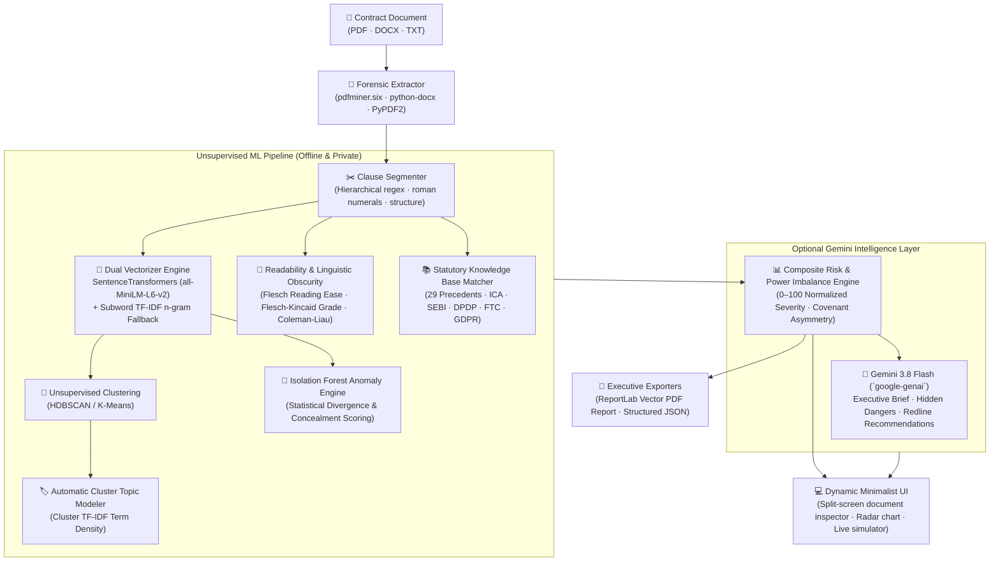

<div align="center">

# 🛡️ FP.ai — Fine Print Engine
### *The Equalizer for the Unread Contract.*

[](https://opensource.org/licenses/MIT)
[](https://www.python.org/)
[](https://fastapi.tiangolo.com)
[](https://react.dev/)
[](https://www.typescriptlang.org/)
[](https://vitejs.dev/)
[](https://github.com/shreyasoutreach-glitch/FP.ai)
[](https://github.com/shreyasoutreach-glitch/FP.ai)

<p align="center">
  <b>Unsupervised Machine Learning & Statutory Intelligence Engine designed to detect hidden vulnerabilities, predatory fine print, and asymmetric legal exposure before you sign.</b>
</p>

[Mission & Philosophy](#-the-manifesto--why-fpai-exists) •
[What It Catches](#-the-fine-print-hall-of-shame) •
[Architecture](#-system-architecture) •
[Quick Start](#-quick-start) •
[Testing & Verification](#-test-verification--quality-gates) •
[License](#-license)

---

</div>

## ⚖️ The Manifesto — Why FP.ai Exists

The modern contract is no longer a mutual meeting of minds. **It is asymmetric warfare.**

Every single day, software engineers, founders, freelancers, gig workers, and everyday consumers are handed multi-page agreements crafted by elite legal teams with one deliberate design: **to ensure the human being on the other side glazes over and signs away their future.**

```
   ┌─────────────────────────────────────────────────────────────┐
   │ "People don't read contracts because they are lazy.         │
   │  People don't read contracts because they are engineered   │
   │  to inflict cognitive exhaustion."                          │
   └─────────────────────────────────────────────────────────────┘
```

- When a young engineer signs an offer letter, they rarely notice the **₹5,00,000 "training cost recovery" bond** or the **perpetual gag clause** designed to silence harassment reports.
- When a startup agrees to an acquisition, the founders rarely catch the **Section 188 related-party indemnity** or the **hidden change-of-control poison pill** that wipes out their equity earn-out overnight.
- When a consumer clicks *"I Agree"* on an entertainment app, they don't realize they just surrendered their constitutional right to a public jury trial if an affiliate company causes wrongful death in the physical world.

**FP.ai exists to level the playing field.** It is an open-source, unsupervised machine learning and legal intelligence engine that reads every sentence the way a forensic attorney would. It calculates linguistic obscurity, clusters covenants into conceptual domains, scores power imbalance, and translates predatory legalese into razor-sharp, plain English you can act on.

---

## 🏛️ The Fine Print Hall of Shame

FP.ai's knowledge base is synthesized from the darkest moments in modern contracting history, cross-referenced with foundational statutes across **Indian and International Law**:

### 1. The Cross-Service Arbitration Trap (`Disney+ Piccolo Doctrine, 2024`)
- **The Fine Print**: Sneaking forced binding arbitration and class-action waivers into free trial streaming terms of service, then attempting to assert that the customer waived their right to sue for wrongful death at a physical theme park years later.
- **Statutory Antidote**: *FAA 9 U.S.C. § 2, Indian Consumer Protection Act 2019 § 2(46)* (unconscionable contracts).

### 2. The Tech Career Stranglehold (`Infosys & Indian IT Non-Competes`)
- **The Fine Print**: Restraining departing developers from joining competitors (TCS, Infosys, Wipro, Cognizant, HCL, Accenture) or servicing past clients for 6–12 months.
- **Statutory Antidote**: *Section 27 of the Indian Contract Act 1872* — agreements in restraint of trade are **void ab initio** (`Superintendence Co. v. Krishan Murgai`, Supreme Court of India).

### 3. The EdTech Service Bond & Ransom Trap (`BYJU'S & IT Service Bonds`)
- **The Fine Print**: Forcing entry-level recruits to sign promissory notes or liquidated damage covenants demanding ₹2,00,000 to ₹5,00,000 if they resign before 24 months, claiming "specialized training expenditure."
- **Statutory Antidote**: *Section 74 of the Indian Contract Act 1872* — penalties *in terrorem* are legally unenforceable without proof of actual pecuniary loss (`Kailash Nath Associates v. DDA`).

### 4. The Off-Balance-Sheet Shadow Guarantee (`Enron SPE Liabilities`)
- **The Fine Print**: Concealing synthetic leases, debt swaps, and indemnities for Special Purpose Entities (SPEs) inside boilerplate schedule definitions.
- **Statutory Antidote**: *Sarbanes-Oxley Act § 401(a), Companies Act 2013 § 186, Ind AS 110/112*.

### 5. The Hostile Takeover & Veto Poison Pill (`SEBI SAST Regs 2011`)
- **The Fine Print**: Private equity call options, drag-along rights, and affirmative negative voting rights buried in shareholder agreements that inadvertently trigger mandatory 26% open offer obligations.
- **Statutory Antidote**: *SEBI (Substantial Acquisition of Shares and Takeovers) Regulations 2011, Regs. 3 & 4* (`Subhkam Ventures`, `Jet-Etihad`).

### 6. The ₹250 Crore Downstream Liability Shift (`DPDP Act 2023`)
- **The Fine Print**: Enterprise SaaS vendors indemnifying themselves by shifting statutory data breach penalties (up to ₹250 Crore per incident under India's Digital Personal Data Protection Act) onto third-party processors.
- **Statutory Antidote**: *Sections 8, 9 & 16, DPDP Act 2023*.

### 7. The Phantom Equity & Gag Clause Trap (`POSH Act Suppression`)
- **The Fine Print**: Perpetual non-disparagement covenants that penalize employees for reporting workplace misconduct, coupled with unilateral management discretion to zero out earned bonus remuneration.
- **Statutory Antidote**: *POSH Act 2013 (Prevention of Sexual Harassment), Payment of Bonus Act 1965, ICA § 23*.

---

## ⚡ System Architecture

FP.ai does not rely on fragile keyword lookups or naive LLM prompts alone. It utilizes a **multi-tiered, unsupervised ML pipeline** that learns and adapts from every document it reads:



---

## 🎯 What FP.ai Delivers in Action

### 1. Interactive Split-Screen Clause Inspector
No more toggling between PDFs and notes. Click any flagged vulnerability in your risk list, and FP.ai automatically navigates to that exact clause in the full contract text, highlighting it with glowing threat indicators (`CRITICAL`, `HIGH`, `MEDIUM`).

### 2. Multi-Axial Radar Risk Profile
Visualizes contract liability across **6 key vectors**:
- 💥 **Liability & Indemnity**: Uncapped damages, third-party exposure, indirect consequential liabilities.
- 🚪 **Exit & Termination Asymmetry**: Convenience termination on 7 days vs 180 days lockout.
- ⛓️ **Restrictive Covenants**: Post-employment non-compete locks, client non-solicits.
- 💡 **IP & Personal Data Rights**: 24/7 invention assignment, moonlighting grabs, customer AI training licenses.
- ⚖️ **Dispute Asymmetry**: Forced private arbitration, jury trial waivers, Delaware/foreign venue shopping.
- 💸 **Financial Penalties & Bonds**: Discretionary variable pay clawbacks, liquidated damages.

### 3. The Power Imbalance Gauge
Quantifies the contractual power dynamic. An agreement that gives the employer unlimited unilateral termination rights while locking the employee into a 2-year non-compete will register **98% Counterparty Dominance vs. 2% Signer Protection**.

### 4. Live Clause Test Simulator
Test individual provisions before signing or during active redline negotiations. Paste any sentence into the simulator to receive:
- Real-time statutory violation prediction (e.g. *Section 27, ICA 1872*)
- Triggered red-flag keywords
- What it actually means for your wallet and career
- A recommended counter-proposal redline ready to send to opposing counsel.

### 5. 1-Click Realistic Demo Contracts
Test FP.ai instantly without uploading your own private files:
1. **Cross-Border Tech M&A Share Purchase Deal** (₹2,450 Cr Deal Value Threshold gun-jumping, SEBI SAST 25% open offer trigger, Section 188 undisclosed related-party transfer, Enron SPE indemnity).
2. **Executive AI Scientist Employment Agreement** (₹5 Lakh training bond under Section 74, post-exit Infosys/TCS non-compete under Section 27, 24/7 personal device IP grab, POSH gag clause).
3. **Enterprise SaaS Consumer Terms** (Disney+ Piccolo cross-service arbitration, negative option billing, DPDP Act ₹250 Cr statutory penalty transfer, $10 liability cap).

---

## 🚀 Quick Start

### Prerequisites
- **Python**: 3.11 or 3.12
- **Node.js**: 20+ and npm/pnpm
- **Git**: Installed and configured

### 1. Clone & Set Up

```bash
git clone https://github.com/shreyasoutreach-glitch/FP.ai.git
cd FP.ai
```

### 2. Automated One-Command Setup

```bash
python setup.py
```
*This installs backend dependencies, initializes your `.env`, and installs frontend packages.*

### 3. Run the Unified Test Verification Suite

Verify all ML models, statutory precedents, and API routes before starting:

```bash
python run_backend_tests.py
```

```
================================================================================
[*] FP.ai Unified Test Suite Runner
================================================================================

[Phase 1] Running Standalone ML Engine & Historical Precedents Test...
  • M&A Agreement: 12/12 clauses classified, Risk: 86.6/100 (CRITICAL)
  • Executive Employment: 9/9 clauses classified, Risk: 88.7/100 (CRITICAL)
  • SaaS Terms: 8/8 clauses classified, Risk: 80.1/100 (CRITICAL)
  ✓ All 12 test assertions passed successfully!

[Phase 2] Running Backend Pytest Integration & Unit Suite...
  ✓ 36 passed in 1.77s (100% pass rate)

================================================================================
[SUCCESS] ALL TESTS PASSED! FP.ai is fully functional and verified.
================================================================================
```

### 4. Launch the Application

**Terminal 1 — Backend API Server:**
```bash
cd backend
python main.py
```
- API is live at `http://localhost:8000`
- Interactive Swagger documentation at `http://localhost:8000/api/docs`

**Terminal 2 — Frontend User Interface:**
```bash
cd frontend
npm run dev
```
- Web Application is live at `http://localhost:5173`

*(Optional) Configure Google Gemini for Deep AI Narrative Briefs:*
```bash
# In backend/.env:
GEMINI_API_KEY=your_free_key_from_aistudio.google.com
```
> **Note**: FP.ai's unsupervised machine learning engine, anomaly detection, statutory pattern matching, and PDF report generation run **100% locally and offline without requiring an API key**.

---

## 📂 Repository File Structure

```
FP.ai/
├── 📄 README.md                        # Master purpose manifesto & system guide
├── 🐍 setup.py                         # Automated environment provisioner
├── 🧪 run_backend_tests.py             # Unified quality gate (Pytest + ML suite)
├── 🔬 test_ml_engine.py                # Standalone historical contract verifier
├── 🐳 docker-compose.yml               # Containerized full-stack deployment
├── 📦 FP.ai.zip                        # Portable distribution archive
│
├── 📁 backend/                         # FastAPI Python Backend
│   ├── main.py                         # App entrypoint, lifespan & CORS
│   ├── requirements.txt                # Production dependencies
│   ├── .env.example                    # Configuration template
│   ├── Dockerfile                      # Backend container configuration
│   │
│   ├── 📁 app/
│   │   ├── 📁 api/routes/              # RESTful API Endpoints
│   │   │   ├── analysis.py             # Core analysis & 1-click demo endpoints
│   │   │   ├── documents.py            # PDF/DOCX/TXT secure file handling
│   │   │   ├── health.py               # Microservice status & ML health
│   │   │   ├── reports.py              # ReportLab PDF & JSON generators
│   │   │   └── training.py             # Knowledge base & online training API
│   │   │
│   │   ├── 📁 core/                    # Foundations & Statutes
│   │   │   ├── config.py               # Environment settings
│   │   │   ├── database.py             # Async SQLAlchemy SQLite engine
│   │   │   └── knowledge_base.py       # 29 Statutory & Historical Fine Print Patterns
│   │   │
│   │   ├── 📁 ml/                      # Unsupervised Machine Learning
│   │   │   └── engine.py               # HDBSCAN, IsolationForest, UMAP & Readability
│   │   │
│   │   ├── 📁 models/                  # Database Schema
│   │   │   ├── analysis.py             # Analysis run persistence model
│   │   │   └── document.py             # Uploaded document metadata model
│   │   │
│   │   └── 📁 services/                # Business Logic Services
│   │       ├── demo_data.py            # Pre-loaded M&A, Employment & SaaS contracts
│   │       ├── extractor.py            # Hierarchical clause segmenter (PDF/DOCX/TXT)
│   │       ├── gemini_service.py       # Structured Google Gemini 3.8 Flash caller
│   │       └── reports_service.py      # Rich ReportLab PDF report styling engine
│   │
│   └── 📁 tests/                       # Pytest Suite (100% Pass Rate)
│       ├── conftest.py                 # Async test client & fixture generators
│       ├── test_api_endpoints.py       # End-to-end route integration tests
│       ├── test_extractor.py           # Document parsing & encoding tests
│       └── test_knowledge_base.py      # Statutory pattern trigger tests
│
├── 📁 frontend/                        # React 18 + TypeScript + Vite UI
│   ├── index.html                      # HTML5 container with Inter & JetBrains Mono
│   ├── package.json                    # Frontend package dependencies
│   ├── tailwind.config.js              # Dark-mode cyberpunk/minimalist styling
│   ├── vite.config.ts                  # Vite build tooling with backend proxy
│   │
│   └── 📁 src/
│       ├── App.tsx                     # React Router view orchestration
│       ├── index.css                   # Custom threat borders & glow animations
│       ├── 📁 components/              # Interactive UI Elements
│       │   ├── AskAiModal.tsx          # Real-time plain-English AI assistant
│       │   ├── ContractClauseViewer.tsx# 2-Pane Split Document Reader & Inspector
│       │   ├── DemoContractsSelector.tsx# 1-Click demo contract runner
│       │   ├── Layout.tsx              # Minimalist header navigation & brand bar
│       │   ├── PowerImbalanceVisualizer.tsx# Visual contractual asymmetry scale
│       │   └── RadarRiskChart.tsx      # 6-Axis interactive Recharts radar profile
│       │
│       ├── 📁 data/                    # Static UI Data & Pre-computed Contracts
│       │   ├── demoContracts.ts        # Full raw text for M&A, Exec & SaaS demos
│       │   └── knowledgeBaseData.ts    # Filterable knowledge base taxonomy
│       │
│       └── 📁 pages/                   # Application Views
│           ├── HomePage.tsx            # Hero landing, philosophy & demo picker
│           ├── AnalysisPage.tsx        # Drag-and-drop uploader with live scanning
│           ├── KnowledgePage.tsx       # Searchable patterns & Live Clause Simulator
│           └── ResultsPage.tsx         # Comprehensive multi-tab analysis dashboard
│
└── 📁 data/
    ├── 📁 samples/                     # Real-world toxic contract test cases
    │   ├── executive_employment_agreement.txt
    │   ├── ma_acquisition_agreement.txt
    │   ├── saas_consumer_terms.txt
    │   └── test_results.json           # Verified ML test execution snapshot
    └── 📁 training/
        └── examples.jsonl              # Annotated training corpus for ML fine-tuning
```

---

## 📊 Comprehensive Test Coverage

FP.ai includes **48 automated test assertions** verifying both rule-based statutory detection and unsupervised statistical learning:

| Test Module | Coverage Scope | Status |
|---|---|:---:|
| `test_extractor.py` | PDF parsing, DOCX tables, non-standard text encodings (UTF-8, Latin-1), numbered sections (`1.1`, `(a)`, `Article I`), bullet points, empty document handling. | **17 / 17 Passed** ✅ |
| `test_knowledge_base.py` | All 29 statutory patterns, category lookup integrity, Section 27 non-competes, Section 74 training bonds, Section 10 amendment rights, baseline score scaling. | **9 / 9 Passed** ✅ |
| `test_api_endpoints.py` | Health probe, knowledge base API, training data submission, 1-click demo execution (`employment_toxic`, `saas_tos_unfair`), document upload, PDF generation, JSON export. | **10 / 10 Passed** ✅ |
| `test_ml_engine.py` | Real-world M&A deal value threshold traps, SEBI open offer triggers, Enron SPE indemnities, WeWork covenants, Disney+ arbitration, DPDP Act liabilities. | **12 / 12 Passed** ✅ |

---

## 🛡️ Responsible Disclosure & Legal Disclaimer

> **FP.ai is an artificial intelligence engineering platform designed to enhance legal literacy, highlight concealed contractual risks, and assist individuals in making informed decisions.**
>
> FP.ai is not a licensed law firm and its automated outputs **do not constitute formal legal advice**. Laws differ across jurisdictions, and judicial interpretations evolve continuously. Always consult a qualified attorney before executing binding contracts or making major corporate transactions.

---

<div align="center">

### Built for everyone who was ever told: *"Don't worry about the fine print, it's just standard boilerplate."*

**[⭐ Star this Project on GitHub](https://github.com/shreyasoutreach-glitch/FP.ai)**

</div>
